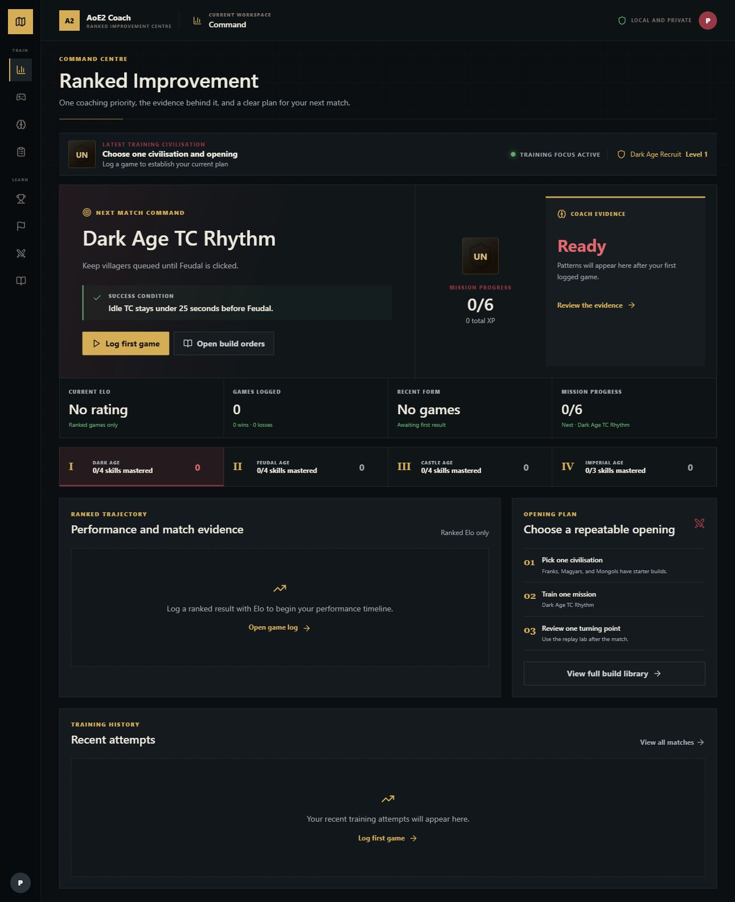
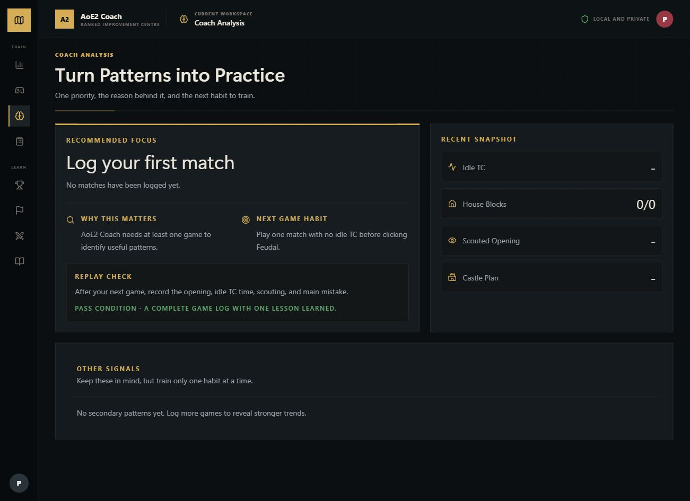
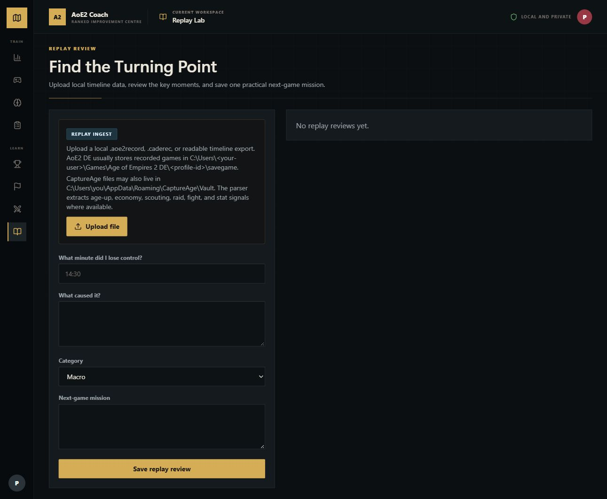

# AoE2 Coach

AoE2 Coach is a local-first desktop and web companion for tracking and improving Age of Empires II play. It is built for beginners and developing ladder players who want structured practice, clear habits to work on, and a more useful way to review games than a spreadsheet.

The app is available as a compiled Windows application and can also run locally in a browser. There is no backend, account system, cloud upload, or API key requirement.

## Current Interface

### Command Centre



### Coach Analysis



### Replay Lab



## What It Does

- Track current Elo, peak Elo, games played, win rate, XP, and level progress.
- Log ranked games with civs, map, opening, Castle Age time, idle TC time, scouting, housing, 2 TC transition, mistakes, and lessons.
- Analyse logged games and imported replays to surface evidence-based coaching priorities.
- Generate player-specific training goals from replay evidence, including age-up timing, idle Town Centre time, military production, Castle Age expansion, and unspent resources.
- Turn replay-derived goals into Mission Board tasks with clear success conditions.
- Complete missions for XP and progression.
- Work through a beginner-focused skill tree from Dark Age to Imperial Age.
- Browse build orders for beginner scout openings.
- Review replays with a chronological match timeline, player tracks, age transitions, economic and military signals, turning-point notes, and a next-game mission.
- Upload a local AoE2 `.aoe2record`, CaptureAge `.caderec`, or readable export. Current DE `.aoe2record` files are decoded locally for player identities, civilizations, AI opponents, age timings, building and research milestones, military-production signals, resource snapshots, and estimated idle-TC time by age. AoE2 DE recordings are usually stored in `C:\Users\<you>\Games\Age of Empires 2 DE\<profile-id>\savegame`; `.caderec` parsing remains experimental.
- Browse civilization crests, beginner civ suggestions, and playstyle tags.

## Privacy

AoE2 Coach stores personal gameplay data in browser LocalStorage:

```text
aoe2coach.games
aoe2coach.missions
aoe2coach.skills
aoe2coach.reviews
```

That data is not written to repo files and is not pushed to GitHub. The repository contains only app code, sample coaching content, and static UI data.

## Tech Stack

- React
- TypeScript
- Vite
- Tailwind CSS
- Recharts
- LocalStorage persistence

## Windows Setup

Install Node.js LTS from [nodejs.org](https://nodejs.org/), then from PowerShell:

```powershell
npm install
npm run dev
```

Open the local URL Vite prints, usually:

```text
http://localhost:5173
```

## Windows Desktop App

AoE2 Coach is packaged as a portable Windows desktop application using Electron. The generated `.exe` does not require a separate browser window or a running development server.

### Run The Compiled App

After building, open:

```text
release\AoE2-Coach-0.1.0-x64.exe
```

Because the application is currently unsigned, Windows SmartScreen may ask you to confirm that you want to run it.

### Desktop Development

Install the dependencies, then launch Vite and Electron together:

```powershell
npm install
npm run desktop:dev
```

### Create A Windows Build

```powershell
npm run desktop:build
```

The compiled app is written to:

```text
release/
```

The `release/` folder is ignored by Git, so compiled desktop builds do not get pushed to GitHub. Publish the `.exe` separately as a GitHub Release when you want other people to download it.

## macOS Setup

Install Node.js LTS from [nodejs.org](https://nodejs.org/) or with Homebrew:

```bash
brew install node
```

Then from Terminal:

```bash
npm install
npm run dev
```

Open the local URL Vite prints, usually:

```text
http://localhost:5173
```

## Project Status

This is v0.1: a working local-first coaching companion with browser and Windows desktop modes. The current version includes manual match tracking, missions, skill progression, build orders, local replay parsing, chronological replay evidence, and dynamically generated coaching goals.

Future work includes broader replay-event coverage, more precise economy and army statistics, match-up notes, additional build orders, data import/export, and macOS desktop packaging.

See [ROADMAP.md](ROADMAP.md) for planned requirements and future product direction.
